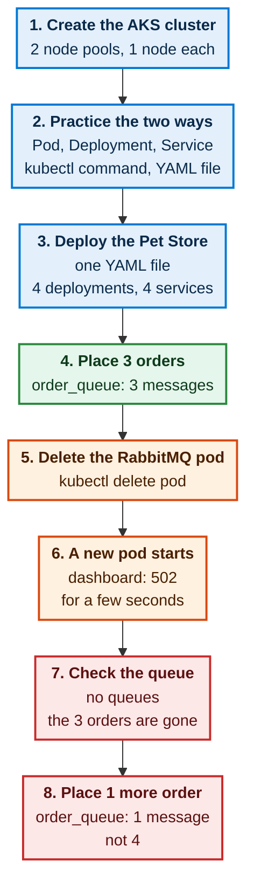
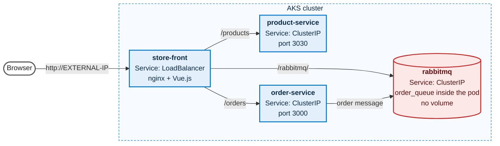
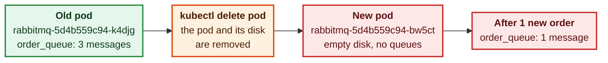

# CST8915 Lab 7: Kubernetes Basics with kubectl and YAML

- **Student Name**: Hye Ran Yoo
- **Student ID**: 041145212
- **Course**: CST8915 Full-stack Cloud-native Development
- **Semester**: Fall 2026

---

## Demo Video

🎥 [Watch Demo Video](https://youtu.be/K5UYUsmyxjU)

---

## Lab 6 and Lab 7: What Is Different

Both labs use the same AKS cluster setup and the same YAML file. The goal is different.

| | Lab 6 | Lab 7 |
|---|---|---|
| Goal | Deploy the Pet Store on AKS | Look inside the YAML file and find a problem |
| How I created resources | One `kubectl apply` with the YAML file from the lab | Two ways: `kubectl` commands and my own YAML files |
| The YAML file | I used it as it is | I read each part of it |
| The pod I deleted | A `store-front` pod | The `rabbitmq` pod |
| What happened | A new pod started. Nothing was lost. | A new pod started. The orders in the queue were lost. |
| What I learned | Kubernetes brings a pod back | Kubernetes does not bring the data back |

In short: Lab 6 showed that the app runs on Kubernetes. Lab 7 showed that a pod that keeps data needs more than a Deployment.

---

## What This Lab Does

1. Create an AKS cluster with two node pools.
2. Create a Pod, a Deployment, and a Service in two ways: with a `kubectl` command and with a YAML file.
3. Deploy the Algonquin Pet Store with one YAML file.
4. Place 3 orders and check the queue in the RabbitMQ dashboard.
5. Delete the RabbitMQ pod.
6. Kubernetes starts a new RabbitMQ pod.
7. Check the queue again.
8. Place 1 more order and check the queue.

Blue is the setup. Green is the state before the delete. Orange is the delete. Red is the result.

---

## Environment

- Resource group: `AlgonquinPetStoreRG`, region Canada Central
- AKS cluster: `AlgonquinPetStoreCluster`, preset Dev/Test, pricing tier Free, Kubernetes 1.36.5
- Node pools:
  - `masterpool`: System mode, Standard_D2as_v4, Manual, 1 node
  - `workerspool`: User mode, Standard_D2as_v4, Manual, 1 node
- Commands were run in Azure Cloud Shell (Bash).

---

## Two Ways to Create a Resource

A `kubectl` command says "create this now". A YAML file says "this is the state I want". The result in the cluster is the same. The difference is that the YAML file stays, so I can use it again and keep it in Git.

| Resource | With a `kubectl` command | With a YAML file | What I saw |
|---|---|---|---|
| Pod | `kubectl run my-pod --image=nginx --port=80` | `kubectl apply -f my-pod.yaml` | `my-pod 1/1 Running` both times |
| Deployment | `kubectl create deployment my-deployment --image=nginx` | `kubectl apply -f my-deployment.yaml` | The YAML file has `replicas: 3`, so 3 pods were Running |
| Service | `kubectl expose deployment my-deployment --type=LoadBalancer --port=80` | `kubectl apply -f my-service.yaml` | A `LoadBalancer` service on port 80 |

Each YAML file has the same four parts: `apiVersion`, `kind`, `metadata`, and `spec`.

After the practice, I deleted these resources. `kubectl get all` showed only the default `kubernetes` service.

---

## The Pet Store on AKS

One file, `algonquin-pet-store-all-in-one.yaml`, creates 8 resources. The resources are separated by `---`.

- Only `store-front` has a public IP. The other three services are `ClusterIP`, so they are only inside the cluster.
- The three blue services keep no data. The red one, `rabbitmq`, keeps the orders.
- The RabbitMQ Deployment in the file has an image, ports, environment variables, and resources. It has no `volumes` and no `volumeMounts`.

---

## Written Analysis of the RabbitMQ Configuration Issues

### 1. Whether RabbitMQ is a stateless or stateful application

RabbitMQ is **stateful**.

- RabbitMQ keeps the queues and the messages. This data is its state.
- `store-front` and `product-service` are different. If their pod changes, nothing is lost.
- If the RabbitMQ pod changes, the orders it was keeping are lost.

### 2. The implications of running RabbitMQ without persistent storage

- The RabbitMQ Deployment has no volume. So the data is only inside the pod.
- The data lives as long as the pod lives. When the pod is gone, the queue and the messages are gone too.
- The queue was durable. The dashboard showed `D` in the Features column. Durable means the queue is saved on disk. But the disk was inside the pod, so it did not help.
- There was no error message. The orders were lost silently. The customer placed an order, but the store does not know about it.

### 3. What happens when the RabbitMQ pod is deleted or restarted

This is what I saw in the demo.

1. Before the delete, `order_queue` had 3 messages.
2. I deleted the pod with `kubectl delete pod rabbitmq-5d4b559c94-k4djg`.
3. The Deployment created a new pod right away, `rabbitmq-5d4b559c94-bw5ct`. It was Running after about 12 seconds.
4. For a few seconds, the RabbitMQ dashboard showed `502 Bad Gateway`. RabbitMQ was not running, so nginx could not reach it.
5. After the new pod started, the dashboard showed `no queues`. The 3 orders were gone.
6. I placed 1 more order. It worked, and `order_queue` was created again. It had 1 message, not 4.

Kubernetes brought the pod back, but it did not bring the data back. The new pod starts empty.

### 4. Potential solutions to this problem (research-based)

1. **Give RabbitMQ persistent storage.**
   - Create a PersistentVolumeClaim and mount it at the RabbitMQ data folder, `/var/lib/rabbitmq`.
   - Then the data is saved outside the pod. On AKS this can be an Azure Disk. A new pod can read the same data.
2. **Use a StatefulSet instead of a Deployment.**
   - A StatefulSet is made for stateful applications. The pod keeps the same name, for example `rabbitmq-0`, and each pod gets its own volume.
   - The RabbitMQ blog also says to use a StatefulSet and a Persistent Volume.
3. **Use a managed messaging service.** See question 5.

Sources:

- Kubernetes documentation, [Persistent Volumes](https://kubernetes.io/docs/concepts/storage/persistent-volumes/)
- Kubernetes documentation, [StatefulSets](https://kubernetes.io/docs/concepts/workloads/controllers/statefulset/)
- RabbitMQ blog, [Deploying RabbitMQ to Kubernetes: What's Involved?](https://www.rabbitmq.com/blog/2020/08/10/deploying-rabbitmq-to-kubernetes-whats-involved)

### 5. Does using Azure Service Bus solve the issues identified with RabbitMQ Configuration in this Lab?

Yes, it solves the problem I found in this lab.

- Azure Service Bus is a managed backing service. The queue is not inside a pod in my cluster. It is inside Azure.
- If my pods are deleted or restarted, the messages are still in Azure.
- In this lab, RabbitMQ is an owned backing service. I am responsible for setup, health monitoring, scaling, and failover. With a managed service, the cloud provider handles scaling, backup, and maintenance.
- There is a trade-off. With a managed service I have less control, and the cost is based on usage.

---

## Notes

- **A new Cloud Shell session used another subscription.** `az aks get-credentials` failed with `AuthorizationFailed`. I ran `az account set --subscription "Azure for Students"` first, and then it worked.
- **The external IP needs time.** `kubectl get services` showed the IP quickly, but the browser could open it only after 1 to 2 minutes.
- **Clean up.** After the demo, I deleted the resource group `AlgonquinPetStoreRG`.

---

## Acknowledgments

- Lab instructions: [ramymohamed10/26F_CST8915_Lab7](https://github.com/ramymohamed10/26F_CST8915_Lab7)
